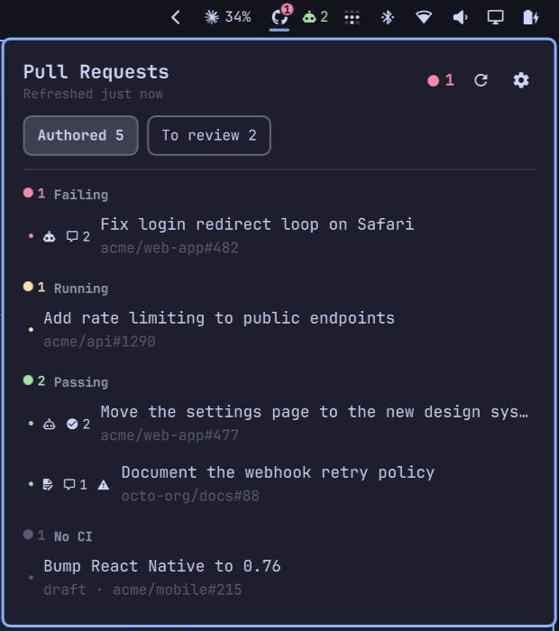

# GitHub PRs

An Omarchy bar widget for your open GitHub pull requests: their CI status, reviews, and the PRs that wait for your review.



## What it does

- The bar shows the GitHub icon with a badge. The badge has the worst CI status among your PRs and how many PRs have it: red when a check failed, yellow while checks run, green when every check passed.
- Click the icon to open a popup with your PRs grouped into Failing, Running, Passing, and No CI. Click a PR to open it in the browser.
- The **Authored** tab lists the PRs you opened. The **To review** tab lists open PRs that wait for your review, asked from you or from one of your teams, with who opened each one. Press `h`/`l` or Left/Right to switch tabs. The badge and the notifications count only your authored PRs.
- Each row shows the number of approvals, a mark when changes are requested, the number of unresolved review threads, and an alert when the PR has merge conflicts.
- A robot icon shows the AI review result. It is filled while a thread started by an AI reviewer is unresolved, and an outline when the AI review is clean. See `aiCheckNames` below.
- Under the title, a label shows when the PRs were last refreshed, such as "Refreshed 3 min ago". Click the refresh button in the header, or press `r`, to poll GitHub now.
- You get a notification when CI passes or fails, when a reviewer approves or requests changes, when someone else writes new code comments, when the AI review is done, and when someone else merges or closes your PR. Click it to open the PR. You can turn off each one in Settings.

## Requirements

The [GitHub CLI](https://cli.github.com/), logged in:

```bash
gh auth login
```

The token needs the `read:org` scope to read your teams. `gh auth login` grants it by default.

## Install

```bash
omarchy plugin add https://github.com/lucasATeixeira/omarchy-gh-prs --enable
```

This clones the plugin into `~/.config/omarchy/plugins/io.github.lucasateixeira.gh-prs/` and adds it to the right side of the bar. To update it later, run `omarchy plugin update io.github.lucasateixeira.gh-prs`.

## Remove

```bash
omarchy plugin remove io.github.lucasateixeira.gh-prs
```

## Settings

Click the gear in the popup header. Changes apply right away. You can also set them on the widget's entry in `~/.config/omarchy/shell.json`:

| Key | Default | Meaning |
| --- | --- | --- |
| `refreshIntervalSec` | `30` | Seconds between GitHub queries, from 5 to 3600. |
| `authoredMaxAgeDays` | `365` | Hide authored PRs with no update in this many days, from 1 to 365. Hidden PRs leave the list and the badge but still send notifications. |
| `toReviewMaxAgeDays` | `365` | Hide PRs to review when nobody asked you or your teams to review them in this many days, from 1 to 365. With no request found, the days count from when the PR was opened. |
| `hideMyApprovedPrs` | `true` | Hide PRs to review that you already approved. |
| `aiCheckNames` | `"CodeRabbit, Copilot"` | Comma-separated AI check patterns. A check whose name contains a pattern is an AI check. A user or bot whose login contains one is an AI reviewer. The AI review is done when an AI check or an AI reviewer's review exists, every AI check has finished, and no AI reviewer has a pending review request. Copilot posts only a review, with no check. Leave it empty to turn this off. |
| `notificationsEnabled` | `true` | Turn off to stop every notification. |
| `notifyAiReviewDone` | `true` | Notify when the AI review is done: "AI review: changes suggested" or "AI review: no changes suggested". |
| `notifyCiPassed` | `true` | Notify when CI passed. |
| `notifyCiFailed` | `true` | Notify when CI failed. |
| `notifyApproved` | `true` | Notify when a PR is approved. |
| `notifyChangesRequested` | `true` | Notify when changes are requested. |
| `notifyCodeComments` | `true` | Notify when someone else writes new code comments on your PR. |
| `notifyMerged` | `true` | Notify when someone else merges your PR. |
| `notifyClosed` | `true` | Notify when someone else closes your PR. |

## Development

- `js/prs.js` holds the logic: the GraphQL query, the status rules, grouping, and theme colors.
- `Panel.qml` holds the bar badge and the popup. `SettingsView.qml` holds the settings page.
- Run the tests:

  ```bash
  node --test tests/prs.test.js
  ```

- Saving a file does not always reload the running widget. Run `omarchy restart shell` to see QML changes.

The spec is in `.agent/scratch/gh-prs/spec.md`. The domain terms are in `.agent/GLOSSARY.md`.

## License

MIT. See [LICENSE](LICENSE).
